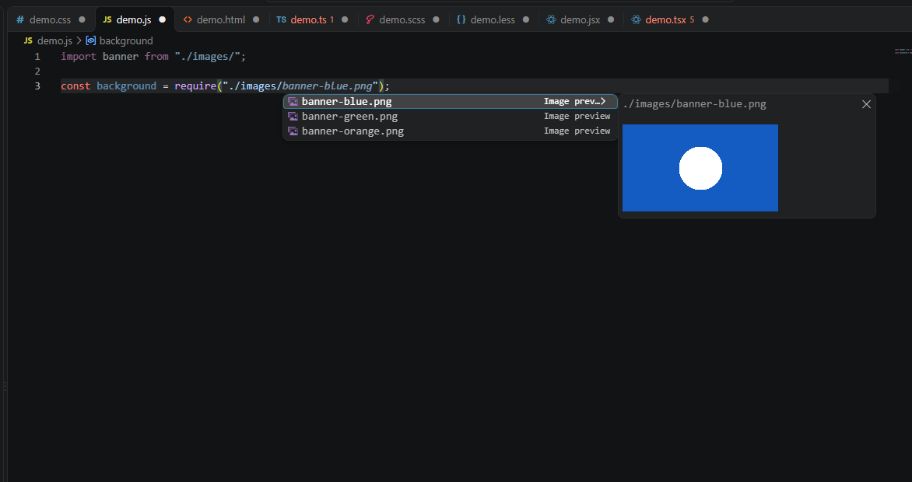
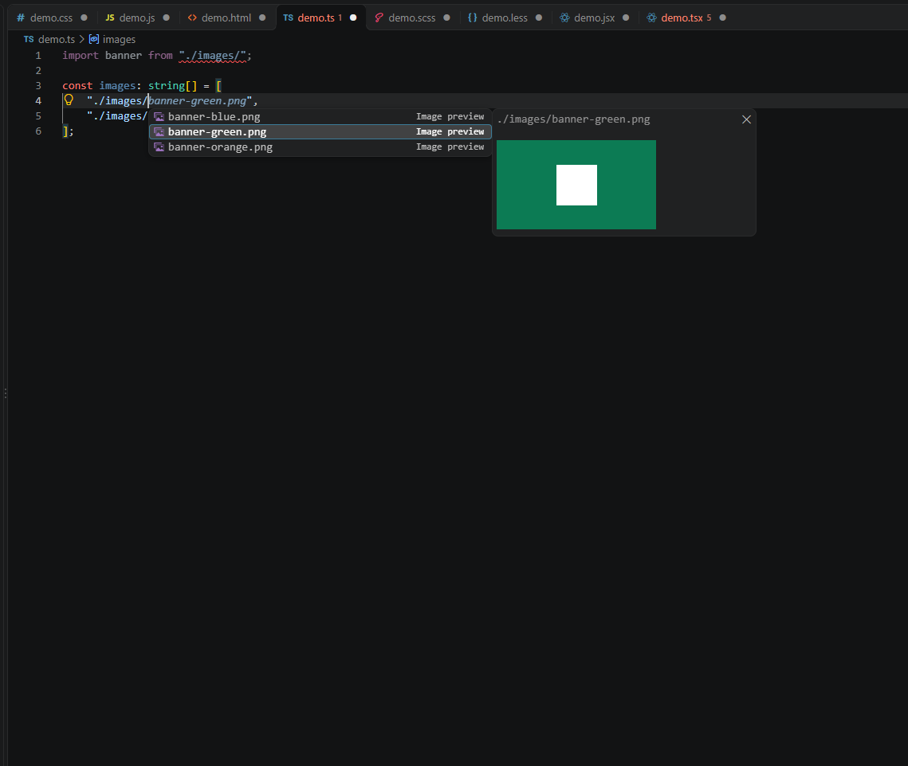
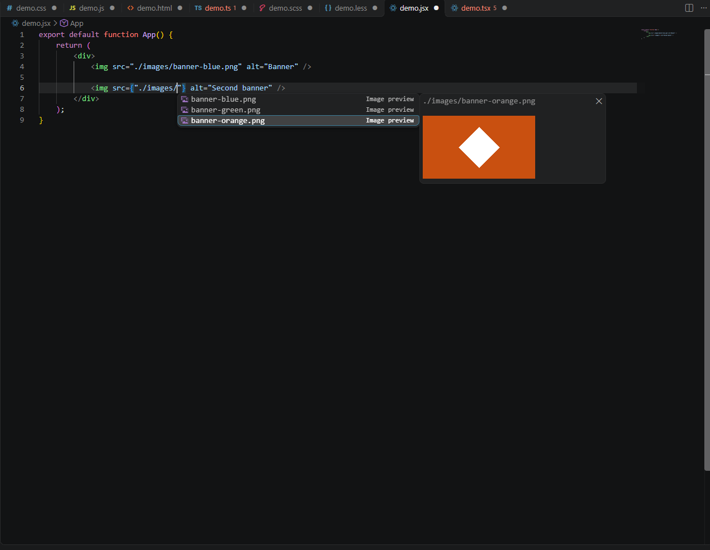
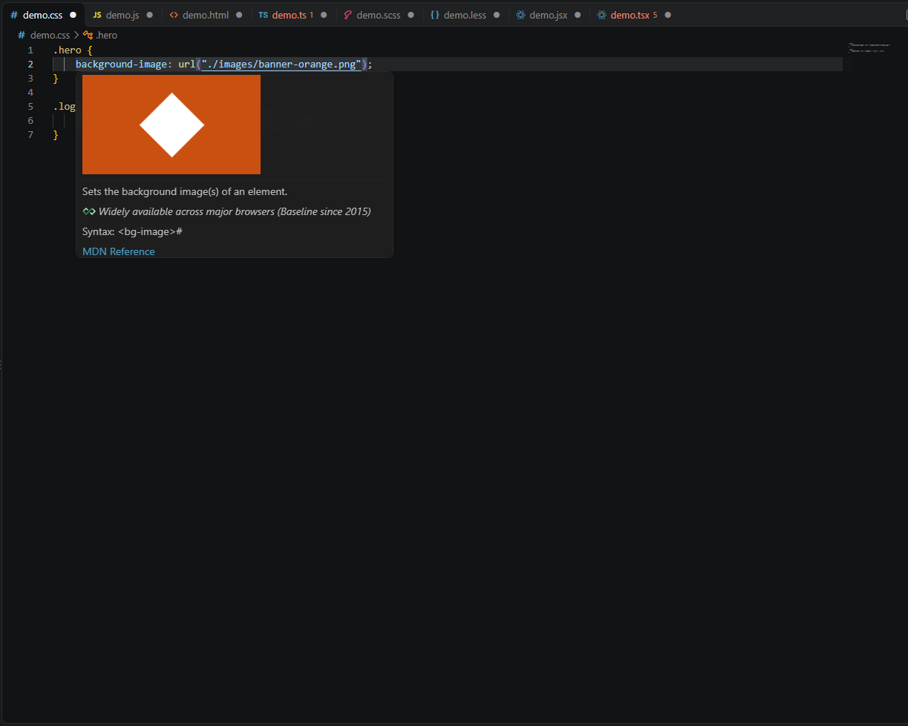

# Image Path Preview

**See the image before you choose it.** Preview image files while browsing autocomplete suggestions in VS Code and compatible editors, including Antigravity. You can also hover over an existing image path to see the image without opening it.

## Image previews in autocomplete

Type an image path such as `./images/`, press **Ctrl+Space** if suggestions don't appear, and use **↑ / ↓** to preview each image. Press **Enter** to insert the selected filename.

**JavaScript**

**TypeScript**

**React JSX**

## Hover preview

Hover over an image path already written in your editor to see a thumbnail in the tooltip.

## Supported

- **Languages:** JavaScript, TypeScript, JSX/TSX, HTML, CSS, SCSS, LESS.
- **Formats:** PNG, JPEG, GIF, WebP, SVG.
- **Paths:** Local relative image paths and common web-project `public/` paths.
- **Privacy:** Reads local workspace images only. No external image requests.

**Note:** If VS Code also shows its built-in filename suggestions, choose those labeled **Image preview** for thumbnails. The extension doesn't change your image files.
